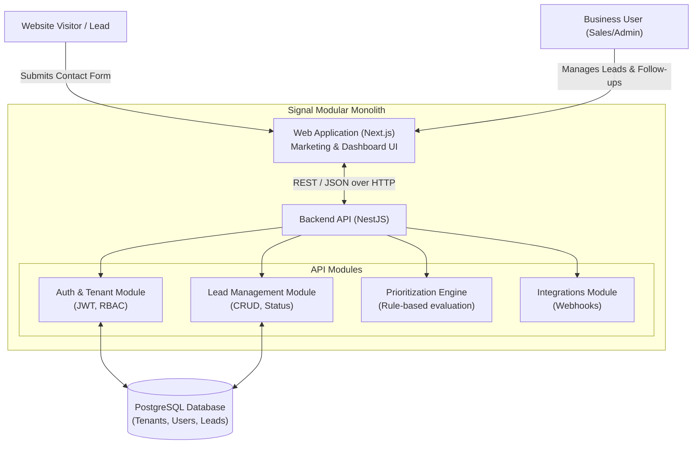
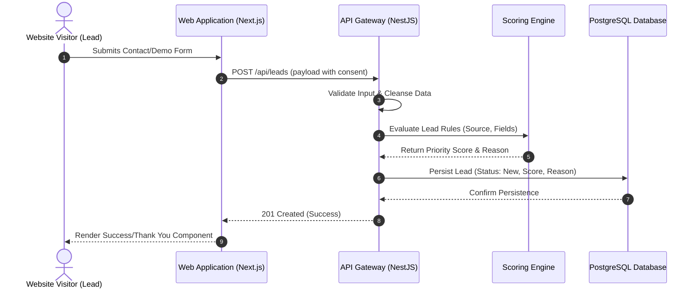
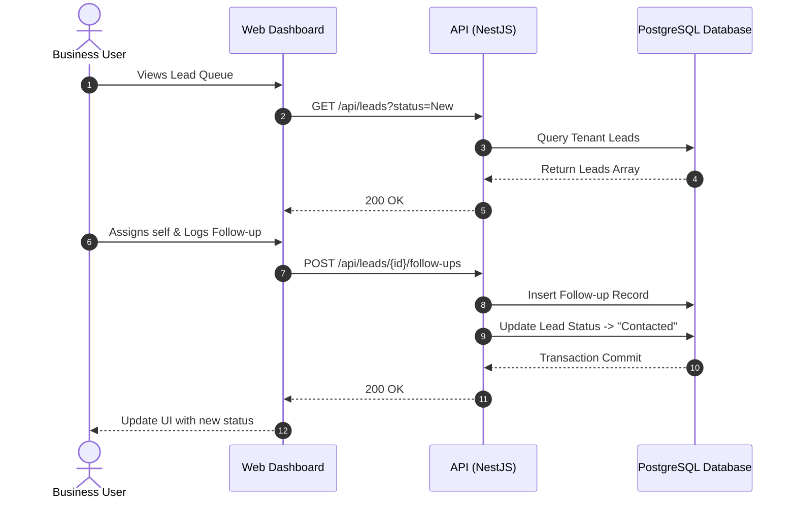
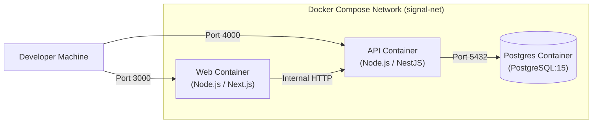

# High-Level Design (HLD)

## 1. System Context and Scope

Signal helps businesses capture, prioritize, and follow up on leads. The MVP is scoped to a responsive web application and a backend API.

**Users & External Systems:**
*   **Business User (Sales/Admin):** Interacts with the dashboard to view leads, follow up, and measure outcomes.
*   **Website Visitor (Lead):** Submits inquiries via the public contact forms.
*   **CRM System (Future Phase):** Potential external integration for lead synchronization.

**Non-Goals for MVP:**
*   Identity resolution of anonymous individuals.
*   Native mobile applications.
*   Complex multi-touch attribution AI.

## 2. Architecture Principles
*   **Modular Monolith:** A unified repository and deployment boundary, but with strict logical separation between domains (Auth, Lead Management, Integrations).
*   **Privacy by Design:** Explicit consent capture, no hidden tracking, and strict tenant data isolation.
*   **Evidence over Vanity Metrics:** Focus on actionable lead metrics and follow-up states.

## 3. Logical Architecture

## 4. Key Workflows / Process Flows

### 4.1 Lead Capture to Prioritization
This diagram outlines the flow of data when a new lead submits an inquiry.

### 4.2 Lead Follow-up Lifecycle
This diagram outlines the business user interaction for following up on a lead.

## 5. Deployment / Docker Topology
For local development, we use Docker Compose to orchestrate the services.

## 6. Technology Choices & Rationale

| Layer | Technology | Rationale |
| :--- | :--- | :--- |
| **Frontend** | React + Next.js (App Router) + Tailwind CSS + shadcn/ui | Next.js provides excellent routing, SSR for marketing pages, and fast client-side rendering for the dashboard. Tailwind + shadcn/ui ensures accessible, premium aesthetics rapidly. |
| **Backend API** | Node.js + NestJS + TypeScript | NestJS strongly enforces the "modular monolith" architecture, providing clear dependency injection, validation pipes, and module boundaries. |
| **Database** | PostgreSQL 15 | Robust relational data integrity required for multi-tenant SaaS. |
| **ORM / Data Access** | Prisma | Excellent type safety bridging TypeScript and PostgreSQL, alongside a deterministic migration system. |
| **Containerization**| Docker & Docker Compose | Ensures parity across developer environments and fulfills the local test requirements. |

## 7. Security, Privacy & Tenant Isolation

*   **Tenant Isolation:** All database tables associated with customer data (Users, Leads, Follow-ups) will have a `tenant_id` foreign key. Prisma middleware or NestJS interceptors will ensure all queries are automatically scoped to the authenticated user's `tenant_id`.
*   **Authentication:** JWT-based session handling. Credentials will be securely hashed using `bcrypt`.
*   **Input Validation:** Strict server-side validation using `class-validator` (NestJS) to prevent injection and malformed data.
*   **Privacy:** Raw leads must include explicit consent fields (`consent_granted`, `consent_timestamp`). Unnecessary personal data will not be logged in application logs.

## 8. External Integrations & Trust Boundaries
*   **Phase 7 Integration:** We will implement one prioritized CRM/webhook boundary.
*   **Failure Handling:** Outbound integrations will feature retry logic and idempotency keys to ensure robust delivery logs and configurable notifications in the event of failure.

## 9. Major Risks
*   **Scope Creep in Prioritization:** Rule-based scoring can easily become overly complex. We must strictly define the V1 ruleset (e.g., specific domains get +10 points, explicit demo requests get +20 points) and avoid attempting AI modeling.
