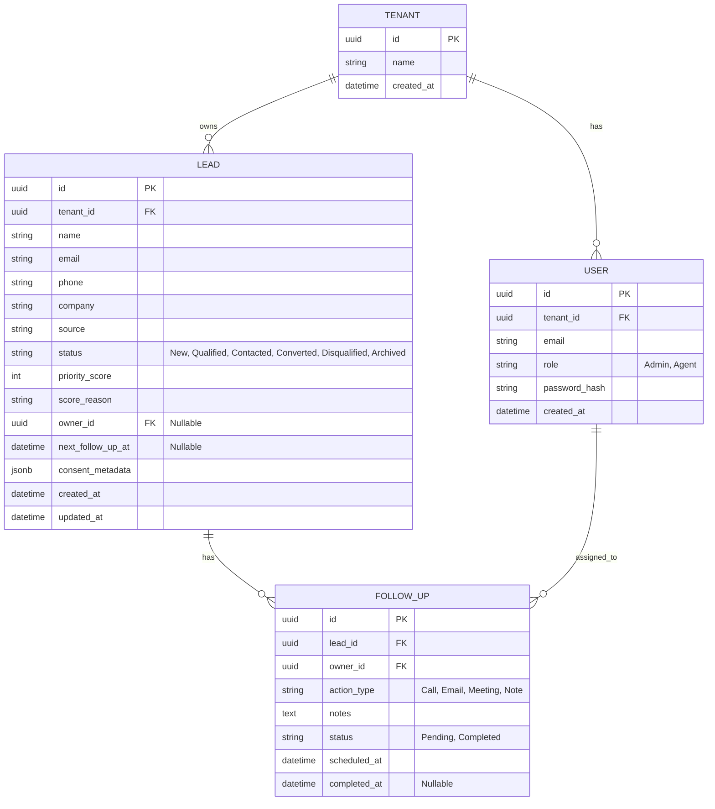
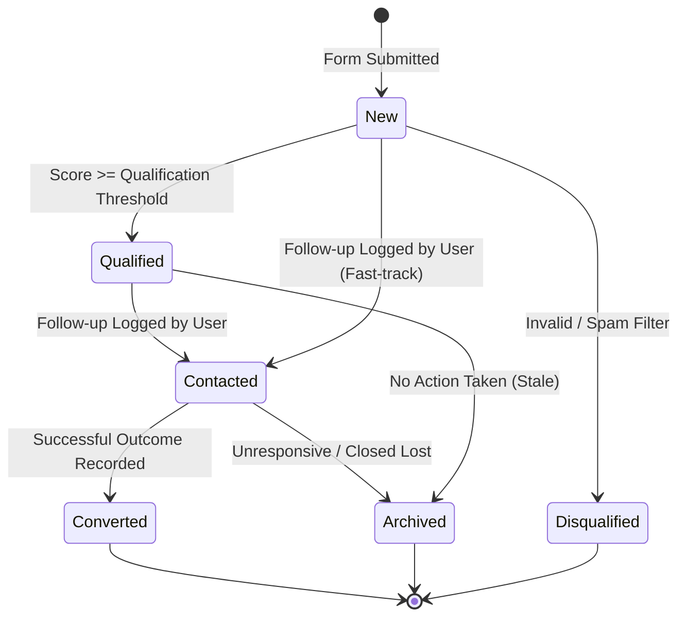

# Low-Level Design (LLD)

## 1. Repository / Module Structure

The project employs a monorepo structure.

```text
signal/
├── apps/
│   ├── web/                     # Next.js Frontend
│   │   ├── app/                 # Next.js App Router (pages & layouts)
│   │   ├── components/          # Reusable React components (shadcn/ui)
│   │   ├── lib/                 # Frontend utilities and API clients
│   │   └── public/              # Static assets
│   └── api/                     # NestJS Backend
│       ├── src/
│       │   ├── auth/            # Auth & Tenant Module
│       │   ├── leads/           # Lead Management Module
│       │   ├── scoring/         # Prioritization Engine Module
│       │   └── common/          # Shared interceptors, filters, decorators
│       └── prisma/              # Database schema and migrations
├── infra/                       # Dockerfiles and compose configs
├── docs/                        # Architecture & requirements (HLD, LLD)
├── scripts/                     # Seed, reset, and utility scripts
├── docker-compose.yml
└── README.md
```

## 2. Route & Page Inventory (Web)

| Route Path | Type | Purpose |
| :--- | :--- | :--- |
| `/` | Public | Home / Marketing Landing Page |
| `/platform` | Public | Explains the product workflow |
| `/solutions` | Public | Explains target use cases |
| `/pricing` | Public | Communicates the commercial model |
| `/contact` | Public | Captures legitimate enquiries (demo request) |
| `/login` | Public | Application entry point (Authentication) |
| `/app` | Protected | Dashboard Overview (KPIs, recent activity) |
| `/app/leads` | Protected | Lead queue / List view |
| `/app/leads/[id]` | Protected | Lead detail and follow-up view |

## 3. Database Entity-Relationship Diagram (ERD)

The relational schema ensures data integrity and tenant isolation.



## 4. Lead Lifecycle Rules

Leads transition through explicit states based on data enrichment and business user actions.



## 5. API Endpoints Contract (Initial)

All protected endpoints will require a valid JWT `Authorization: Bearer <token>` header.

### 5.1 Public Endpoints
*   `POST /api/leads/capture`
    *   **Body:** `{ name, email, company, source, consent_granted }`
    *   **Response:** `201 Created`
*   `POST /api/auth/login`
    *   **Body:** `{ email, password }`
    *   **Response:** `200 OK`, `{ token, user }`

### 5.2 Protected Endpoints (Tenant Scoped)
*   `GET /api/leads`
    *   **Query Params:** `?status=New&sort=priority_score:desc`
    *   **Response:** `200 OK`, `[{ id, name, status, priority_score, ... }]`
*   `GET /api/leads/:id`
    *   **Response:** `200 OK`, `{ id, name, ..., follow_ups: [...] }`
*   `PATCH /api/leads/:id`
    *   **Body:** `{ status, owner_id }`
    *   **Response:** `200 OK`, Lead Object
*   `POST /api/leads/:id/follow-ups`
    *   **Body:** `{ action_type, notes, scheduled_at }`
    *   **Response:** `201 Created`, FollowUp Object

## 6. Authentication & Authorisation Details
*   **Authentication:** JWT issued upon successful `/login`. Token includes `userId`, `tenantId`, and `role`.
*   **Authorization (Tenant Scoping):** An Interceptor/Middleware in NestJS will automatically extract `tenantId` from the JWT and attach it to the Prisma client context. All queries generated by the Lead and FollowUp services will strictly enforce `WHERE tenant_id = current_tenant`.

## 7. Validation Schemas
Input validation will be enforced at the API boundary using `class-validator` and `class-transformer` DTOs.
*   **Lead Capture DTO:** Enforces valid email formats, string lengths, and ensures the `consent_metadata` flag is present.
*   **Follow-Up DTO:** Validates `action_type` against an enum (`Call`, `Email`, `Meeting`, `Note`) and ensures dates are well-formed UTC ISO strings.